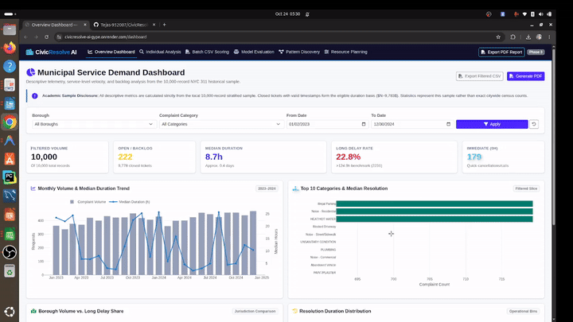
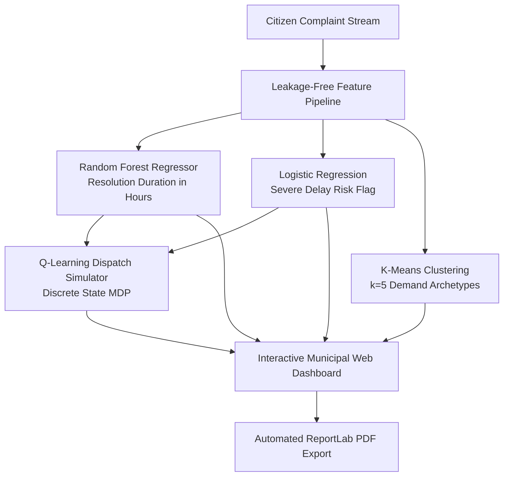

<div align="center">

# 🏛️ CivicResolve AI
### *Explainable Municipal Complaint Intelligence & AI Resource Dispatch*

[](https://www.python.org/)
[](https://flask.palletsprojects.com/)
[](https://scikit-learn.org/)
[](https://plotly.com/)
[](#-automated-testing)
[](#-live-cloud-deployment)

**An intelligent, leakage-free operational dashboard and decision-support platform for municipal civic services.**

[Key Features](#-core-capabilities) • [System Architecture](#-system-architecture) • [Quickstart](#-quickstart) • [Video Demo](#-video-demo) • [Documentation](#-project-documentation)

---

</div>

## 📌 The Problem
Municipal corporations receive tens of thousands of citizen complaints daily (road potholes, water leakage, illegal dumping, heating outages).
* **Static & Reactive Triaging:** Traditional city systems process tickets on a naive first-come, first-served (FIFO) basis.
* **Invisible Delays:** Municipal supervisors cannot forecast which tickets will take weeks to resolve until angry citizens follow up.
* **Resource Misallocation:** Field crews are dispatched without predictive risk prioritization, causing prolonged backlogs and citizen dissatisfaction.

---

## 💡 The Solution
**CivicResolve AI** transforms municipal complaint management into proactive, data-driven operational intelligence:
1. **Intake-Time Duration Forecasting:** Accurately estimates resolution hours at the moment of complaint registration.
2. **Delay Risk Classification:** Flags prolonged delays (>5 days) with an **88.7% recall rate**, preventing service bottlenecks.
3. **Unsupervised Pattern Discovery:** Groups complaints into 5 operational archetypes using **K-Means clustering** ($k=5$) with 2D PCA projection.
4. **Adaptive Dispatch Simulator:** Benchmark **Tabular Q-Learning (Reinforcement Learning)** against heuristic policies (FIFO, Risk-First, Risk-Plus-Wait) to optimize crew capacity.
5. **Automated Administrative Reporting:** Generates high-resolution diagnostic PDF reports via ReportLab with one click.

---

## 🎥 Video Demo & Live Walkthrough
> 📺 **Watch CivicResolve AI in Action!**  
> *A 5-minute end-to-end walkthrough demonstrating intake-time risk prediction, dynamic filtering, K-Means clustering, and Q-learning simulation.*

<div align="center">
  <a href="report/civicresolve_demo_compressed.mp4">
    
  </a>
  <p>
    <b>▶️ <a href="report/civicresolve_demo_compressed.mp4">Click here to watch or download the full 5-minute video walkthrough (MP4)</a></b>
  </p>
</div>

---

## 🖥️ Core Capabilities & UI Tour

<details open>
<summary><b>1. Municipal Intelligence Dashboard</b></summary>
<br>
Real-time KPI cards, volume trends, borough distribution charts, and duration histograms with instant multi-category slice filtering.
<p align="center">
  
</p>
</details>

<details open>
<summary><b>2. Single Complaint Intake Analysis</b></summary>
<br>
Evaluates individual complaint parameters at intake time to output expected resolution duration and a long-duration risk badge.
<p align="center">
  
</p>
</details>

<details>
<summary><b>3. Batch CSV Scoring & Data Quarantine</b></summary>
<br>
Bulk uploads hundreds of complaints, automatically isolates post-resolution leakage columns, and generates downloadable scored CSVs.
<p align="center">
  
</p>
</details>

<details>
<summary><b>4. Unsupervised K-Means Pattern Discovery</b></summary>
<br>
Clusters municipal complaints into 5 distinct operational patterns using PCA 2D projections and segment profiles.
<p align="center">
  
</p>
</details>

<details>
<summary><b>5. Reinforcement Learning Resource Simulator</b></summary>
<br>
Simulates crew dispatch under resource constraints, comparing Q-learning against FIFO and priority heuristics.
<p align="center">
  
</p>
</details>

<details>
<summary><b>6. One-Click Administrative PDF Reports</b></summary>
<br>
Compiles comprehensive operational summaries, KPI scorecards, and model benchmarks into executive-ready PDF documents.
<p align="center">
  
</p>
</details>

---

## 🏗️ System Architecture



---

## 🚀 Quickstart

Run CivicResolve AI locally in three quick steps:

```bash
# 1. Clone repository
git clone https://github.com/Tejas-952007/CivicResolve-AI.git
cd CivicResolve-AI

# 2. Install dependencies
pip install -r requirements.txt

# 3. Start web application
python app.py
```
Open your browser at: **`http://127.0.0.1:5000`**

---

## 🧪 Automated Testing
Includes a hardened test suite covering data integrity, model inference, leak prevention, and adversarial inputs:
```bash
pytest tests/ -v
```
*80 passed in ~24s*

---

## ☁️ Live Cloud Deployment
Configured for **Render.com** (Free Tier):
- Automatic detection via [render.yaml](render.yaml) & [Procfile](Procfile).
- Production WSGI served via `gunicorn`.
- Zero additional configuration needed.

---

## 📄 Project Documentation
- **Full Academic Report (PDF):** [`report/CivicResolve_AI_Final_Report.pdf`](report/CivicResolve_AI_Final_Report.pdf)
- **Examiner Demo & Viva Guide:** [`report/DEMO_GUIDE.md`](report/DEMO_GUIDE.md)
- **Dataset:** Public NYC 311 Service Requests (10,000 stratified records)

---
<div align="center">
  <sub>Developed for B.E. Final Year Project • Explainable Municipal AI Operations</sub>
</div>
